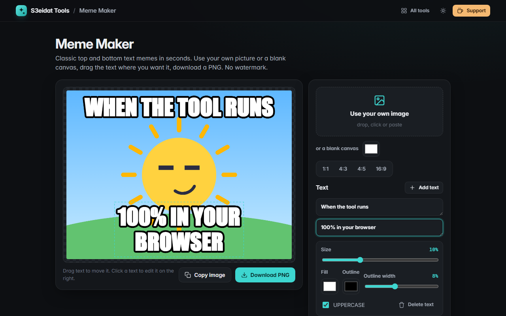

# Meme Maker

> Classic top/bottom text memes in seconds. No watermark. Free, private, and it runs entirely in your browser.

### ▶ [Open Meme Maker](https://s3eidat.github.io/meme-maker/)



## Features

- Your own **image** (drop, click or paste) or a **blank canvas** in any color (1:1, 4:3, 4:5, 16:9)
- Classic **bold outlined meme text** (Impact where your system has it, a heavy sans otherwise)
- **Drag text anywhere** on the image; arrow keys nudge the selected text (Shift for bigger steps)
- **Add as many text boxes** as you like, multi-line, with automatic word wrap
- Per-text **size, fill color, outline color and width**, and an **UPPERCASE** toggle
- **Download PNG** at the image's full resolution (up to 4096 px), or **copy the image** to the clipboard
- **No watermark**, ever

## Privacy


Your images never leave your device. There is no server, no account, no analytics.
The page ships with a strict Content-Security-Policy (`connect-src 'self'`), so the browser
itself blocks any attempt to send data anywhere.

## Run it yourself

It's plain HTML, CSS and JavaScript with no build step:

```bash
git clone https://github.com/s3eidat/meme-maker
cd meme-maker
python -m http.server 8000
```

Then open http://localhost:8000.

## Support

If this saved you time, **[buy me a coffee ☕](https://s3eidat.github.io/coffee/)**. It keeps every tool free.

---

Part of **[S3eidat Tools](https://s3eidat.github.io/)**: 100+ free, private tools that run in your browser. MIT licensed.
